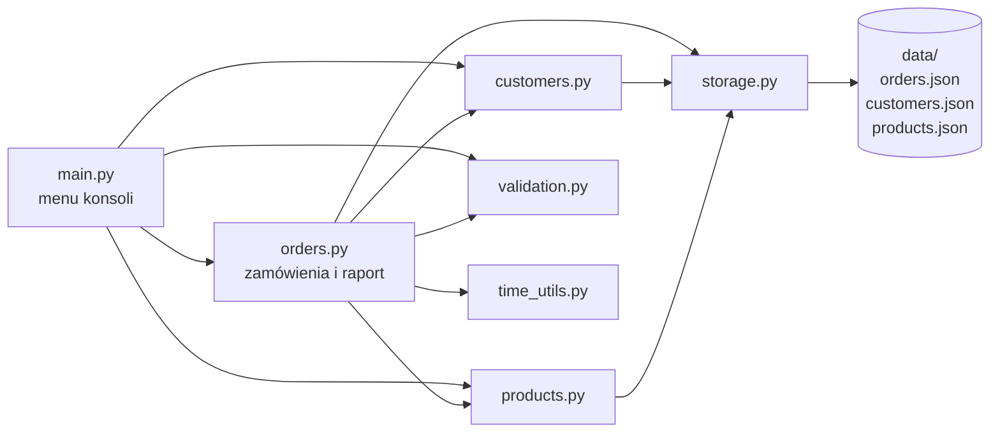
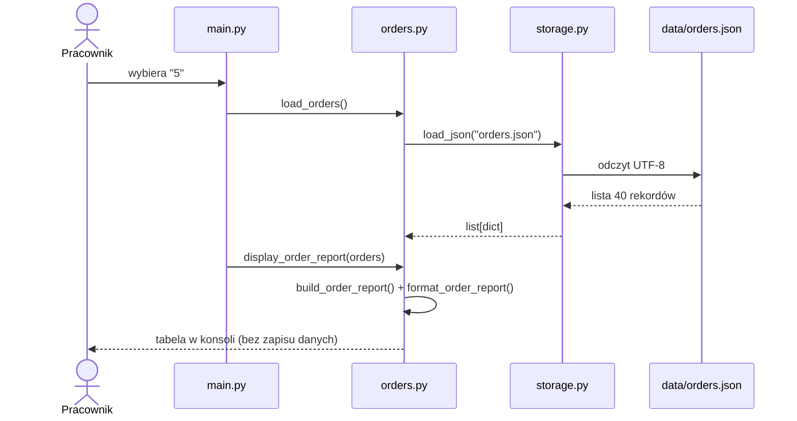

# Lekcja 1 - Analiza istniejącego systemu OrderFlow

> Autor: Łukasz Szymankiewicz (34562), Grupa: INF 3-4 26_27Z, Data: 25.10.2026, Gałąź: `feature/order-reporting`

## Karta pracy zespołu

Zadanie: poznajcie aktualne zachowanie OrderFlow. Nie zmieniajcie kodu. Każdy wniosek potwierdźcie dowodem w pliku, funkcji, teście albo danych.

| Zespół | Data | Role (imiona i nazwiska studentów) |
|---|---|---|
| Łukasz Szymankiewicz (nr albumu 34562), INF 3-4 26_27Z | 25.10.2026 | Łukasz Szymankiewicz - wszystkie role (praca indywidualna) |

## Kontrola punktu startowego

- [x] Pracujemy na tagu v1.0-student-base na własnej gałęzi - git switch -c feature/order-reporting v1.0-student-base (commit a980a81)
- [x] git status nie pokazuje nieoczekiwanych zmian - working tree clean
- [x] python -m pytest -q kończy się wynikiem 9 passed (tests/test_orders.py: 4, tests/test_validation.py: 5)
- [x] python main.py wyświetla menu OrderFlow (opcje 1-5 oraz 0. Zakończ)

```text
$ git switch -c feature/order-reporting v1.0-student-base
Switched to a new branch 'feature/order-reporting'
$ python -m pytest -q
.........                                                                [100%]
9 passed
$ python main.py
============================================
              ORDERFLOW
       Order Management System
============================================
1. Lista zamówień
2. Wyszukaj zamówienie
3. Utwórz zamówienie
4. Zmień status zamówienia
5. Raport zamówień
0. Zakończ
```

## Mapa modułów i zależności



Strzałka oznacza "importuje / wywołuje". Zależności wynikają z instrukcji `import` na początku każdego modułu.

## Mapa odpowiedzialności

| Moduł lub plik | Odpowiedzialność | Wejścia i wyjścia | Dowód |
|---|---|---|---|
| main.py | Punkt wejścia i warstwa konsoli: pętla menu, pobieranie danych od użytkownika, wywołanie funkcji domenowych, komunikaty. Przechwytuje RuntimeError z warstwy danych. | WE: wybór i dane z klawiatury (input). WY: tekst w konsoli, wywołania orders/customers/products. | main(): słownik actions; handle_order_list(), handle_order_search(), handle_order_creation(), handle_status_change(), handle_order_report() |
| orders.py | Logika zamówień: odczyt/zapis, wyszukiwanie po ID, nowy ID, budowa pozycji i rekordu, wartość zamówienia, zmiana statusu, lista, szczegóły oraz raport. Definiuje listy statusów, metod płatności i dostawy. | WE: lista zamówień ze storage, dane z main.py. WY: rekord zamówienia, słownik raportu, sformatowany tekst; zapis orders.json. | create_order(), calculate_order_total(), change_order_status(), build_order_report(), format_order_report(); KNOWN_ORDER_STATUSES, MANAGEABLE_ORDER_STATUSES |
| customers.py | Odczyt klientów, wyszukiwanie klienta po ID, prezentacja imienia i nazwiska. | WE: data/customers.json. WY: słownik klienta albo None, tekst. | load_customers(), find_customer_by_id(), get_customer_name() |
| products.py | Katalog produktów: odczyt, wyszukiwanie, filtr dostępnych, formatowanie cen (format_price jest używane również w raporcie i liście zamówień). | WE: data/products.json. WY: produkt/lista produktów, tekst z kwotą "0.00 zł". | get_available_products(), find_product_by_id(), format_price() |
| storage.py | Wspólny odczyt i zapis plików JSON w katalogu data/, ścieżki względem katalogu projektu, zapis przez plik tymczasowy, zamiana błędów technicznych na RuntimeError. | WE: nazwa pliku, lista rekordów. WY: lista rekordów albo RuntimeError; plik *.json. | load_json() (sprawdza, czy dane są listą), save_json() (temporary_path.replace(path)) |
| validation.py | Reguły walidacji wejścia: format identyfikatorów, dodatnia liczba całkowita, wartość z zamkniętej listy, e-mail, struktura pozycji zamówienia. | WE: tekst/wartości od użytkownika. WY: znormalizowana wartość albo ValueError z komunikatem. | is_valid_identifier(), parse_positive_integer(), require_choice(), validate_order_items(); tests/test_validation.py |
| time_utils.py | Jedno źródło bieżącej daty i czasu (lokalny czas, bez strefy). Miejsce do podmiany czasu w testach. | WE: brak. WY: datetime.now(). | get_current_datetime() wywoływane w create_order() przy ustawianiu created_at |
| data/*.json | Trwałe dane demonstracyjne: 40 zamówień (od ORD-0001 do ORD-0040, z okresu 02.05-14.08.2026), klienci CUS-xxx, produkty PRD-xxx. | Czytane przy każdej operacji; zapisywany jest tylko orders.json. | orders.json: pola id, customer_id, created_at (ISO z godziną), status, payment_method, delivery_method, items[unit_price], total |
| tests/ | Testy jednostkowe zamówień i walidacji (9 testów). | WE: prawdziwy plik data/orders.json oraz dane w teście. WY: wynik pytest. | test_orders.py (load_orders() na danych produkcyjnych demo), test_validation.py; pytest.ini -> testpaths = tests |

## Pierwszy wniosek

**Najważniejsza rzecz, którą odkryliśmy o strukturze systemu:** System ma prosty układ warstwowy: main.py (konsola) -> moduły domenowe (orders, customers, products, validation) -> storage.py -> pliki data/*.json. Cała logika raportu znajduje się w orders.py (build_order_report + format_order_report) i zawsze działa na pełnej liście zamówień z load_orders() - nie ma żadnego filtrowania po dacie, więc raport okresowy da się dodać jako wybór zamówień przed obliczeniem raportu, bez zmiany warstwy danych.

## Prześledzony przepływ danych

Wybrana akcja: 5. Raport zamówień (od menu do wyniku w konsoli).

| Krok | Plik i funkcja | Co wchodzi | Co wychodzi |
|---|---|---|---|
| 1 | main.py - main() | Tekst "5" wpisany w menu (input) | Wywołanie handle_order_report() ze słownika actions |
| 2 | main.py - handle_order_report() | Brak parametrów | Nagłówek show_section("RAPORT ZAMÓWIEŃ"), wywołanie load_orders() |
| 3 | orders.py - load_orders() -> storage.py - load_json("orders.json") | Nazwa pliku; ścieżka z get_data_path() = <projekt>/data/orders.json | Lista 40 słowników zamówień (albo RuntimeError, gdy plik nie istnieje / zły JSON / to nie lista) |
| 4 | orders.py - build_order_report(orders) | Lista wszystkich zamówień (bez filtra) | Słownik: order_count = 40, total_value = 17333.50 (round 2), status_counts i status_values dla 6 statusów |
| 5 | orders.py - format_order_report(report) + products.py - format_price() | Słownik raportu | Tekst: liczba, łączna wartość, tabela STATUS / LICZBA / WARTOŚĆ |
| 6 | orders.py - display_order_report() -> print() | Gotowy tekst raportu | Wynik w konsoli: 40 zamówień, 17333.50 zł (w tym CANCELLED: 4 / 1079.40 zł); dane nie są zapisywane |



## Cztery pytania analityczne

**1. Gdzie aplikacja odczytuje i zapisuje dane?**

Wyłącznie przez storage.py: load_json() i save_json() na plikach data/orders.json, customers.json, products.json. Dane są czytane przy każdej operacji (brak pamięci podręcznej). Zapisywany jest tylko orders.json - w add_order() (nowe zamówienie) oraz w main.handle_status_change() przez save_orders(). Zapis jest atomowy: najpierw plik .tmp, potem replace().

**2. Gdzie powstaje wartość zamówienia i raport?**

Wartość zamówienia powstaje w orders.calculate_order_total() (suma quantity x unit_price, zaokrąglenie do 2 miejsc) w momencie create_order() i jest zapisywana w polu total; unit_price kopiowana jest z katalogu w build_order_item(). Raport liczy orders.build_order_report() - sumuje zapisane pole total (nie przelicza pozycji ani cen katalogowych), a formatuje go format_order_report().

**3. Gdzie odbywa się walidacja danych użytkownika?**

W validation.py (is_valid_identifier, parse_positive_integer, require_choice, validate_order_items), wywoływanej z main.py (handle_order_search, handle_order_creation, choose_from_list, handle_status_change) oraz z orders.py (create_order, change_order_status). W systemie nie ma dziś żadnego parsowania ani walidacji dat wpisywanych przez użytkownika.

**4. Które moduły może objąć przyszła zmiana i dlaczego?**

orders.py - wybór zamówień po created_at i raport okresowy (ponowne użycie build_order_report); main.py - nowa operacja w menu i pobranie zakresu dat; validation.py - walidacja dat (format, kolejność); time_utils.py - ewentualnie "dzisiejsza" data i testowalność; tests/ - nowe testy. storage.py i data/ nie powinny się zmienić, bo raport nie może modyfikować danych (BR pkt 11).

## Pytania do Product Ownera

| Nr | Pytanie | Dlaczego kod nie daje odpowiedzi |
|---|---|---|
| 1 | Czy zamówienia CANCELLED mają wchodzić do łącznej wartości raportu okresowego, czy mają być pokazane osobno? | build_order_report() sumuje total wszystkich statusów razem z CANCELLED - kod pokazuje stan obecny, a nie zamierzoną definicję "wartości sprzedaży". |
| 2 | Czy data końcowa okresu jest włącznie, tzn. obejmuje zamówienia do 23:59:59 ostatniego dnia? | created_at zawiera godzinę (np. 2026-05-02T09:15:00), a w kodzie nie ma żadnej logiki zakresów dat. |
| 3 | W jakim formacie pracownik ma wpisywać daty (np. RRRR-MM-DD) i czy potrzebne są skróty typu "wczoraj", "bieżący miesiąc"? | Aplikacja nie przyjmuje dziś dat od użytkownika; jedyny format w systemie to ISO w pliku JSON. |
| 4 | Czy podział na statusy ma pokazywać status bieżący (z chwili generowania), czy status z końca okresu? | change_order_status() nadpisuje pole status - system nie przechowuje historii zmian statusów. |
| 5 | Co ma się stać, gdy rekord zamówienia ma brakującą lub niepoprawną datę, status albo wartość? | Kod zakłada poprawne dane (order["total"], order["status"]); brak klucza kończy się KeyError, którego main() nie przechwytuje. |

## Ryzyka i niewiadome

| Nr | Ryzyko lub niewiadoma | Dowód albo obserwacja |
|---|---|---|
| 1 | Brak historii statusów: raport za ten sam miesiąc wygenerowany później może dać inny podział na statusy (napięcie z BR pkt 11 i przypadkiem 7). | change_order_status() robi order["status"] = normalized_status; w orders.json nie ma pola z historią; dozwolone są też zmiany "wstecz" (np. DELIVERED -> NEW). |
| 2 | Błędy na granicach dnia i strefy czasu: daty są tekstem ISO bez strefy, liczone z czasu lokalnego komputera. | create_order(): get_current_datetime().isoformat(timespec="seconds"); time_utils.datetime.now(); sort_orders_by_date() porównuje napisy. |
| 3 | Testy działają na prawdziwym pliku danych, więc nowe testy raportu okresowego mogą zależeć od danych demo i zmieniać wynik po utworzeniu zamówienia w aplikacji. | tests/test_orders.py: load_orders() czyta data/orders.json; add_order() zapisuje do tego samego pliku. |
| 4 | Niespójny rekord może wywrócić aplikację zamiast dać czytelny komunikat; sumy statusów nie są zaokrąglane. | main() łapie tylko RuntimeError (KeyError przejdzie dalej); build_order_report(): status_values["PAID"] = 3952.5000000000005 (zaokrąglane tylko przy wyświetlaniu). |

## Gotowość do oddania karty

- [x] Mamy co najmniej 5 pytań do Product Ownera
- [x] Mamy 3 ryzyka lub niewiadome poparte obserwacjami (4 w tabeli)
- [x] Każdy członek zespołu potrafi wyjaśnić wybrany przepływ (raport: main -> orders -> storage -> orders -> konsola)

## Exit tickets

### Exit ticket numer 1

**1. Jedna rzecz, którą rozumiem po analizie OrderFlow:**

Raport to build_order_report() na pełnej liście z load_orders(); sumuje zapisane pole total, więc zmiany cen katalogowych nie wpływają na historię, a raport okresowy wymaga tylko wybrania zamówień po created_at przed obliczeniem.

**2. Jedna rzecz, o którą musimy zapytać Product Ownera:**

Czy zamówienia CANCELLED wliczamy do głównej wartości raportu okresowego - od tej odpowiedzi zależy sposób liczenia najważniejszej liczby w raporcie.

### Exit ticket numer 2

**1. Jedna rzecz, którą rozumiem po analizie OrderFlow:**

Nie dotyczy - praca indywidualna (zespół jednoosobowy).

**2. Jedna rzecz, o którą musimy zapytać Product Ownera:**

Nie dotyczy - praca indywidualna (zespół jednoosobowy).

### Exit ticket numer 3

**1. Jedna rzecz, którą rozumiem po analizie OrderFlow:**

Nie dotyczy - praca indywidualna (zespół jednoosobowy).

**2. Jedna rzecz, o którą musimy zapytać Product Ownera:**

Nie dotyczy - praca indywidualna (zespół jednoosobowy).

